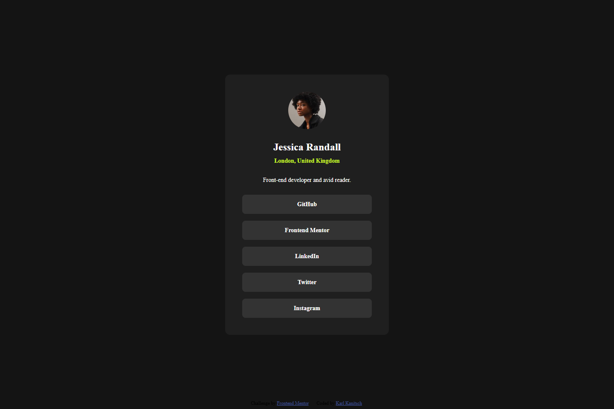
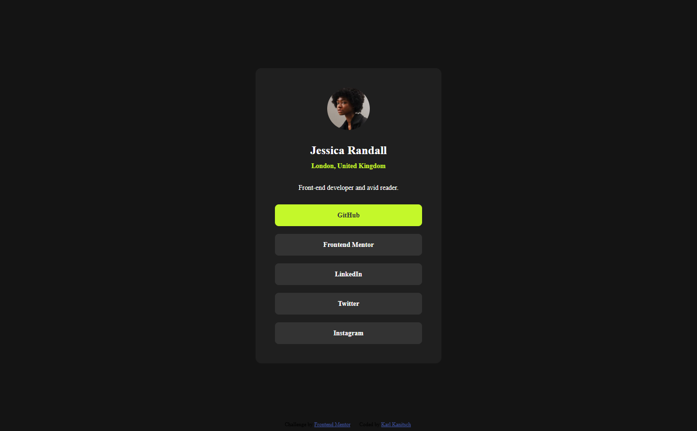
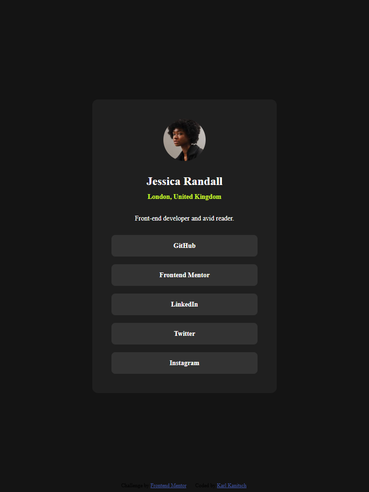
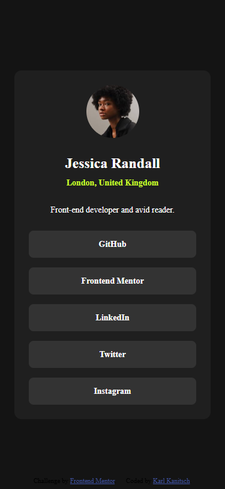

# Frontend Mentor - Social links profile solution

This is a solution to the [Social links profile challenge on Frontend Mentor](https://www.frontendmentor.io/challenges/social-links-profile-UG32l9m6dQ). Frontend Mentor challenges help you improve your coding skills by building realistic projects. 

## Table of contents

- [Frontend Mentor - Social links profile solution](#frontend-mentor---social-links-profile-solution)
	- [Table of contents](#table-of-contents)
	- [Overview](#overview)
		- [The challenge](#the-challenge)
		- [Screenshot](#screenshot)
		- [Links](#links)
	- [My process](#my-process)
		- [Built with](#built-with)
		- [What I learned](#what-i-learned)
		- [Continued development](#continued-development)
		- [Useful resources](#useful-resources)
	- [Author](#author)

## Overview

### The challenge

Users should be able to:

- See hover and focus states for all interactive elements on the page

### Screenshot

- Normal Desktop View 
- Desktop Focus/Hover View 
- Tablet View  
  
- Mobile View  
  

### Links

- Solution URL: [GitHub Repository](https://github.com/kkanit22/FEM-1-3-social-links-preview)
- Live Site URL: [Live Site](https://kkanit22.github.io/FEM-1-3-social-links-preview/)

## My process

### Built with

- Semantic HTML5 markup
- CSS custom properties
- Flexbox
- Mobile-first workflow

### What I learned

Mostly I was reminded not to take things for granted. I don't feel there was anything really new in this challenge, but it is easy to make mistakes using the elements and techniques you already know, such as forgetting that anchor tags require an href.

### Continued development

I hope to continue to learn more about making accessible components to the point that it becomes a part of the process rather than an afterthought.

### Useful resources

- [Google](https://www.google.com) - I still tend to google my questions first and the AI overviews can be surprisingly helpful and accurate. In particular, I couldn't figure out why my anchor elements were not tab selectable until a search explained that they needed to have an href property (which makes sense).

## Author

- Frontend Mentor - [@kkanit22](https://www.frontendmentor.io/profile/kkanit22)
